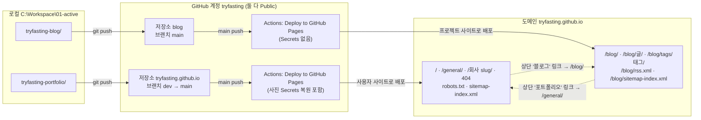
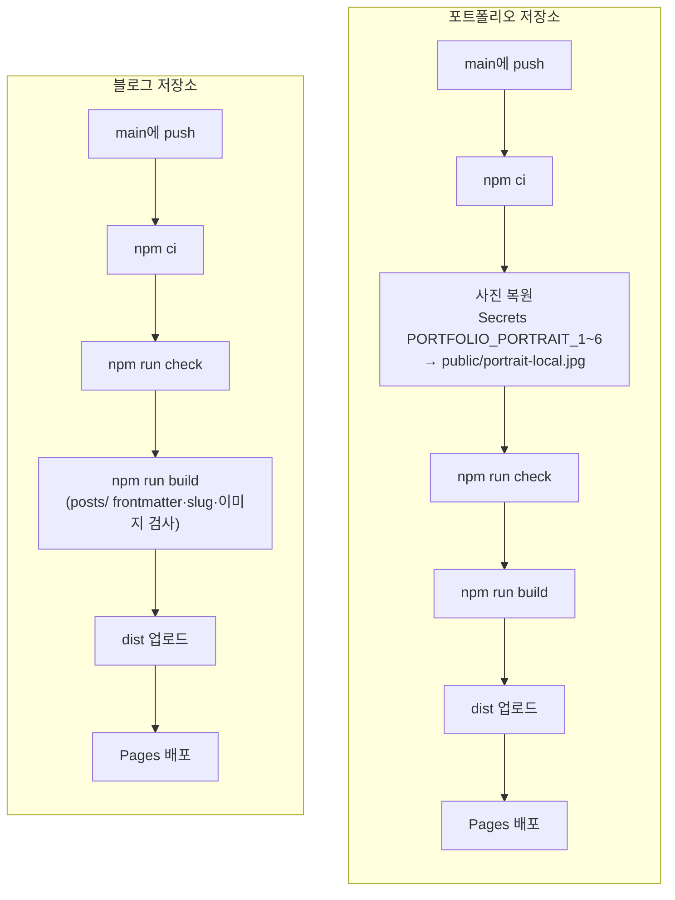

# 사이트 전체 구조 (tryfasting.github.io)

> 이 문서는 `https://tryfasting.github.io` 도메인 전체가 어떻게 만들어지고 배포되는지 설명하는 **원본**이다. 포트폴리오 저장소에 둔다(도메인 루트를 이 저장소가 맡기 때문). 블로그 저장소의 `AGENTS.md`는 이 문서를 가리키기만 하고 복사하지 않는다.
>
> 최종 확인: 2026-10-17

## 한눈에 보기

- 도메인은 **하나**(`https://tryfasting.github.io`)이고, **서로 독립된 GitHub 저장소 두 개**가 나눠서 배포한다.
- GitHub Pages는 계정당 사용자 사이트 1개(저장소 이름 `<계정>.github.io`, 도메인 루트)와, 저장소마다 프로젝트 사이트(`<계정>.github.io/<저장소이름>/`)를 둘 수 있다. 공개 저장소면 무료다.
- 두 저장소는 코드·빌드·패키지 버전·디자인을 **공유하지 않는다.** 서로 거는 일반 링크 두 개로만 연결된다.

| | 포트폴리오 | 블로그 |
|---|---|---|
| GitHub 저장소 | [`tryfasting/tryfasting.github.io`](https://github.com/tryfasting/tryfasting.github.io) | [`tryfasting/blog`](https://github.com/tryfasting/blog) |
| 로컬 폴더 | `C:\Workspace\01-active\tryfasting-portfolio` | `C:\Workspace\01-active\tryfasting-blog` |
| Pages 종류 | 사용자 사이트 | 프로젝트 사이트 |
| 주소 | `/`, `/general/`, `/<회사 slug>/` | `/blog/` 아래 전부 |
| 브랜치 | `dev`에서 작업 → 배포 요청 시 `main` | `main` 하나 (글과 코드 모두) |
| 배포 트리거 | `main`에 push | `main`에 push |
| 배포에 필요한 Secrets | `PORTFOLIO_PORTRAIT_1`~`_6` (사진) | 없음 |
| 프레임워크 | Astro (정적) | Astro (정적, `base: '/blog'`) |
| 검증 | `npm run check` · `npm run build` · `npm run verify` | `npm run check` · `npm run build` · `npm run verify` |
| 에이전트 규칙 | [`AGENTS.md`](AGENTS.md) | `tryfasting-blog/AGENTS.md` |
| 운영 문서 | [`planning/FINAL_HANDOFF.md`](planning/FINAL_HANDOFF.md), [`policy/company-pages.md`](policy/company-pages.md) | `tryfasting-blog/docs/operations.md` |

## 도식 1. 저장소에서 주소까지

## 도식 2. 배포 단계 (각 저장소의 `.github/workflows/deploy.yml`)

- 한 저장소의 배포가 실패해도 다른 저장소의 배포와 사이트에는 영향이 없다. 실패한 쪽도 마지막 성공 배포본이 계속 보인다.
- 블로그에 push해도 포트폴리오는 다시 배포되지 않는다(반대도 같음). 2026-10-17 Actions 실행 기록으로 확인했다.

## 주소를 맡는 저장소

| 주소 | 담당 저장소 | 비고 |
|---|---|---|
| `/` | 포트폴리오 | 한화금융 제출 주소, canonical은 `/hanwha/` |
| `/general/` | 포트폴리오 | 유일하게 검색 색인 허용 |
| `/hanwha/`, `/hanwha-ocean/`, `/cj-olivenetworks/`, `/naver-cloud/`, `/db-group/` | 포트폴리오 | `noindex` |
| `/robots.txt`, `/sitemap-index.xml` | 포트폴리오 | sitemap에는 `/general/`만 |
| 그 밖의 루트 경로의 404 | 포트폴리오 | |
| `/blog/` 아래 전부 (`rss.xml`, `sitemap-index.xml`, 404 포함) | 블로그 | |

**규칙**: 포트폴리오는 `/blog` 경로를 만들지 않고, 회사 slug로 `blog`를 쓰지 않는다. `/blog/`는 `blog` 저장소의 주소다. 새 프로젝트 사이트를 만들 때도 저장소 이름이 곧 경로가 되므로 포트폴리오의 회사 slug와 겹치지 않게 한다.

## 알아 둘 설정

- **새 저장소의 Pages Source는 "GitHub Actions"여야 한다.** Settings → Pages → Build and deployment → Source. 기본값 "Deploy from a branch"이면 워크플로의 배포 단계가 실패한다. 두 저장소 모두 이 설정이다.
- **프로젝트 사이트의 경로는 저장소 이름으로 정해진다.** 저장소 이름이 `blog`라서 `/blog/`다. 저장소 이름을 바꾸면 블로그 주소도 바뀐다.
- **블로그 내부 링크는 `withBase()`로 만든다.** `base: '/blog'` 때문이다. 포트폴리오로 가는 `/general/`만 예외로 base 없이 쓴다.
- **무료 계정이므로 두 저장소 모두 Public이어야** Pages를 쓸 수 있다.

## 해결된 문제 (기록용)

| 날짜 | 일 | 결과 |
|---|---|---|
| 2026-10-17 | `blog` 저장소에서 Pages를 켜는 순간, 아직 배포 전인데도 `/blog/` 주소를 새 저장소가 가져가서 블로그가 몇 분간 404였다 | 새 저장소 첫 배포로 해결. **교훈**: 경로를 새 저장소로 옮길 때는 Pages를 켜기 전에 첫 배포를 바로 올릴 준비를 끝내 둔다 |
| 2026-10-17 | 블로그 RSS 주소가 `/rss.xml` → `/blog/rss.xml`로 바뀌었다 | 의도된 변경. 예전 `/rss.xml`은 404 |

## 로컬 전용 파일 (Git에 올리지 않음)

| 저장소 | 파일 | 제외 방법 |
|---|---|---|
| 포트폴리오 | 사진 원본, `public/portrait-local.jpg`, `planning/private/`, `artifacts/`, `prompt/` | `.gitignore` |
| 포트폴리오 | `.plans/`(작업 계획), 대화 기록 `.txt` | `.git/info/exclude` |
| 블로그 | `DESIGN.md`(디자인 참고 원본), `.plans/`(작업 계획, `BLOG_PLAN.md` 포함) | `.git/info/exclude` |
| 블로그 | `posts/_drafts/`(공개 전 초안), `.obsidian/` | `.gitignore` |

## 변경 이력

| 날짜 | 변경 |
|---|---|
| 2026-09-21 | 포트폴리오 첫 배포 |
| 2026-10-16 | 블로그를 포트폴리오 저장소 안(`/blog/`)에 추가해 함께 배포 |
| 2026-10-17 | 블로그를 별개 저장소 `tryfasting/blog`로 분리(첫 배포 `9e207d5`). 포트폴리오에서 블로그 제거(`d9d5d16`). 로컬 폴더를 `tryfasting-portfolio` / `tryfasting-blog`로 정리 |

## 다음에 읽을 문서

- 포트폴리오 작업: [`AGENTS.md`](AGENTS.md) → [`policy/company-pages.md`](policy/company-pages.md) → [`planning/FINAL_HANDOFF.md`](planning/FINAL_HANDOFF.md)
- 블로그 작업: `tryfasting-blog` 폴더에서 세션을 열고 `AGENTS.md` → `docs/operations.md`
